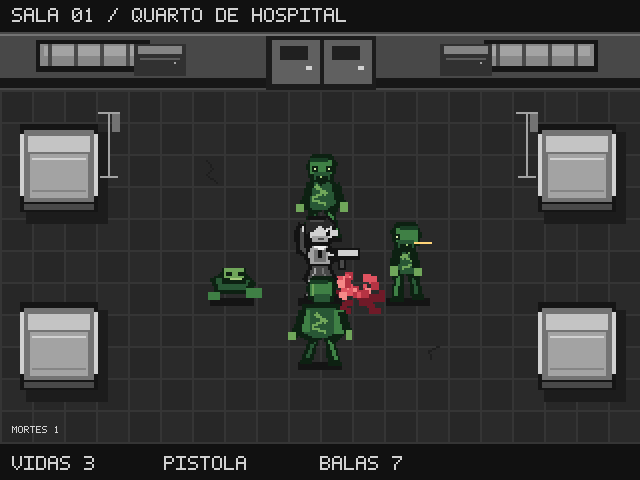
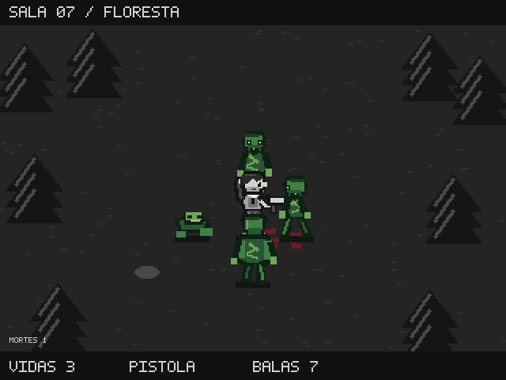

# Gráficos pixelart

A camada visual é opcional e usa `r36s_a11y.graphics.Graphics`. O jogo continua
jogável por áudio, com os controles, regras, tutorial e recordes existentes.

A menina de saia e rabo de cavalo permanece no centro, vista de cima com
inclinação. Personagem, armas e cenários são monocromáticos; zumbis são verdes;
tiros usam cores quentes e sangue é vermelho. Sete ambientes acompanham a
ordem das ondas: quarto de hospital, corredor, estacionamento, cozinha,
metrô, igreja e floresta. Cada arma tem sprites e efeitos próprios. A morte
produz explosão de sangue de 0,5 s e uma mancha temporária de oito segundos.

## Configurações e ciclo de vida

O renderer lê SCREEN e ENERGY sem gravar preferências. SCREEN=0 ou a variável
`A11Y_GRAPHICS=0` mantém o modo somente áudio. Reativar SCREEN abre o vídeo.
O teto visual é 30 fps, 20 em economia moderate e 10 em aggressive, mantendo
a atualização lógica do jogo. Falha no vídeo desliga apenas o renderer.

A pausa congela os efeitos; mudar de sala limpa o cenário. Eventos limitados
a 128 capturam impactos/mortes antes de remover alvos, sem mudar o instante
do dano ou a aleatoriedade do jogo. Texturas e arquivos temporários são
liberados ao fechar vídeo ou sair. HUD e menus usam fonte bitmap, com cache
LRU de até 64 linhas: cada linha é uma chamada de desenho, em vez de uma por
letra. O console não precisa de Pillow.

## Instalar e acompanhar a SDK

`./instalar.sh [host-ssh] [pasta-do-sdk]` prefere o clone da SDK indicado, ou
`../r36s-a11y-sdk` quando existe. Sem clone e sem caminho explícito, usa a
cópia incluída. Um caminho explícito inválido produz erro. O instalador não
faz git pull automaticamente; atualize o clone antes de instalar.

[SDK-ORIGIN.md](../SDK-ORIGIN.md) explica como atualizar a cópia de reserva e
conferir sua origem. `sdk-origin.json` registra commit e hashes. O instalador
inclui os gráficos e não instala com o jogo aberto.

## Testes e autoria

```sh
python3 -m unittest discover -s tests
python3 tools/update_fixtures.py --ref origin/main --check
python3 tools/pixelart/build_preview.py --output previews
```

Pillow é necessário somente para a última etapa, no PC. PNG/GIF são gerados
a partir de coordenadas inteiras, com ampliação 2× sem suavização. Os atlas
transparentes, âncoras e recortes estão em `graphics/manifest.json`.

O fixture de combate é fixado em um commit da main. Após atualizar a base:

```sh
git fetch origin main
python3 tools/update_fixtures.py --ref origin/main
python3 -m unittest discover -s tests
```

Revise a mudança dos arquivos e de `tests/fixtures/origin.json` junto da
mudança de base. Os testes conferem hashes, constantes/reverb e equivalência
de combate, sons, timers e RNG em todas as armas. Não atualize o fixture usando
a própria branch gráfica, pois isso esconderia uma regressão do renderer.

## Validação no R36S

Em 13/10/2026 passaram nove testes no PC e no Python 3.7 do console. A prova
nativa percorreu sete mapas e sete armas, com fala/OpenAL, pausa/retomada,
liberação de vídeo em modo áudio e encerramento. Usa saves privados e o
perfil de áudio que a galeria fornece, incluindo ALSOFT_CONF.

Na amostra de quatro segundos após aquecimento, o cache de linhas apresentou
29,98 fps, mediana de desenho de 8,87 ms e máximo de 14,12 ms. O relatório
anterior, preservado em `native-report.json`, mediu mediana de 12,49 ms; seu
máximo incluía carregamento/capturas e não é diretamente comparável ao
máximo da nova amostra aquecida. A mediana de desenho caiu cerca de 29%.

Callbacks de comandos com sons ainda frios mediram mediana de 36,11 ms e
máximo de 59,20 ms; isso inclui áudio carregado sob demanda, não é latência
física do botão. O maior intervalo de atualização na amostra foi 42,44 ms.
O desenho continua no mesmo loop da entrada/áudio: estes números não são
uma garantia para campanhas prolongadas ou todas as ondas.

Após instalar esta revisão, o usuário jogou uma sala e informou não perceber
atraso na mira/tiro nem cortes no áudio. Essa é uma avaliação humana separada
das medições automatizadas. Relatório atual: [review-report.json](review-report.json).




